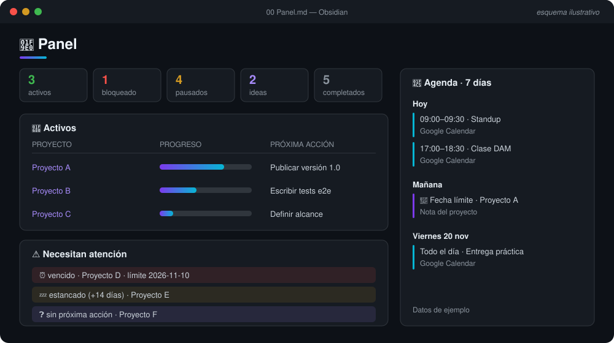
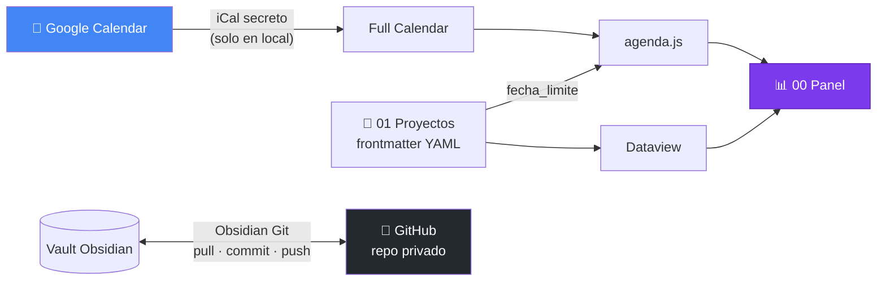
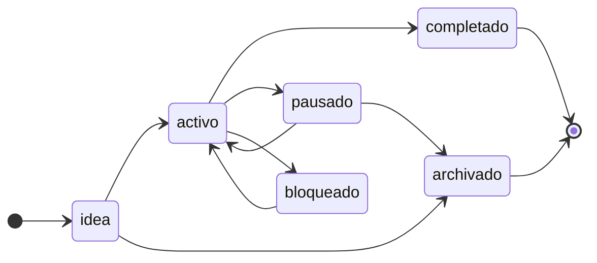

<div align="center">

<picture>
  <source media="(prefers-color-scheme: dark)" srcset="_sistema/assets/banner-dark.svg">
  <source media="(prefers-color-scheme: light)" srcset="_sistema/assets/banner-light.svg">
  
</picture>

<br>

**Todos tus proyectos, tu agenda y tus próximos pasos en un solo lugar.**<br>
Un vault de Obsidian que se sincroniza solo con GitHub y te dice qué está activo, qué se ha estancado y qué vence esta semana.

<br>


[Funciones](#-funciones) ·
[Cómo funciona](#-cómo-funciona) ·
[Instalación](#-instalación) ·
[Uso](#-uso-diario) ·
[Modelo de datos](#-modelo-de-datos) ·
[Roadmap](#-roadmap)

</div>

---

## ✨ Funciones

<table>
<tr>
<td width="50%" valign="top">

### 📊 Panel de control
Estado de todos los proyectos de un vistazo: resumen por estado, barras de progreso, próxima acción y fecha límite, separados en código y personal/creativo.

</td>
<td width="50%" valign="top">

### ⚠️ Alertas automáticas
Señala lo que se está quedando atrás: **vencidos**, **bloqueados**, **estancados** (más de 14 días sin revisión) y proyectos **sin próxima acción**.

</td>
</tr>
<tr>
<td valign="top">

### 📅 Agenda de Google Calendar
Tus eventos de los próximos 7 días junto a las fechas límite de los proyectos. Soporta eventos recurrentes, excepciones y zonas horarias, y la URL privada **nunca** se sube al repo.

</td>
<td valign="top">

### 🔄 Sincronización con GitHub
Obsidian Git hace *pull* al abrir y *commit + push* cada 10 minutos. Historial completo y copia de seguridad sin pensar en ello.

</td>
</tr>
<tr>
<td valign="top">

### 🧩 Plantillas
Proyecto, nota diaria (con la agenda del día), revisión semanal y nota. Todo con el mismo frontmatter, para que el Panel nunca se rompa.

</td>
<td valign="top">

### 🔁 Revisión semanal
30 minutos guiados: vaciar la bandeja, revisar los estancados y limitar los activos. Es lo que evita que el sistema se degrade.

</td>
</tr>
</table>

<div align="center">
  
  <br>
  <sub><i>Esquema ilustrativo del Panel con datos de ejemplo.</i></sub>
</div>

---

## 🧠 Cómo funciona



| Pieza | Papel |
|---|---|
| **Notas de proyecto** | Cada proyecto es un `.md` con frontmatter: estado, prioridad, progreso, fechas y próxima acción. Son la fuente de verdad. |
| **Dataview** | Consulta esas notas como si fueran una base de datos y genera las tablas del Panel. |
| **`agenda.js`** | Lee el calendario iCal, expande los eventos recurrentes y mezcla eventos y fechas límite. |
| **Obsidian Git** | Mantiene el vault y GitHub sincronizados en segundo plano. |

---

## 🚀 Instalación

> [!IMPORTANT]
> Este repositorio debe ser **privado**: contiene tus notas personales.

### 1 · Requisitos

<details>
<summary>Git para Windows y Obsidian</summary>

<br>

- [Git para Windows](https://git-scm.com/download/win). Incluye Git Credential Manager para iniciar sesión en GitHub.
- [Obsidian](https://obsidian.md/download).

</details>

### 2 · Clonar

```powershell
cd $HOME
git clone https://github.com/jmstudio14/cerebrojm.git
cd cerebrojm
git pull   # comprueba que la autenticación funciona
```

> [!WARNING]
> **No** lo clones dentro de OneDrive o Dropbox: dos sincronizadores sobre la misma carpeta corrompen el repositorio `.git`.

### 3 · Abrir en Obsidian

<details>
<summary>Abrir como vault y activar los plugins</summary>

<br>

1. Obsidian → **Open folder as vault** → `C:\Users\<tú>\cerebrojm`.
2. Pulsa **Trust author and enable plugins** (o *Ajustes → Community plugins → Turn on*).
3. Abre **`_sistema/Diagnóstico.md`**: comprueba plugins, calendario y proyectos. Todo debería salir en ✅.
4. Abre **`00 Panel.md`**, que también está en Marcadores.

Los plugins (Dataview, Obsidian Git y Full Calendar) **vienen incluidos** en `.obsidian/plugins/`: no hay que instalar nada.

</details>

### 4 · Conectar Google Calendar

<details>
<summary>Pegar la dirección secreta iCal (solo lectura)</summary>

<br>

1. [Google Calendar](https://calendar.google.com) → ⚙️ **Configuración** → tu calendario → **Integrar el calendario**.
2. Copia la **Dirección secreta en formato iCal** (termina en `basic.ics`).
3. Obsidian → **Ajustes → Full Calendar → Add calendar → iCal** → pega la URL.
4. Repite para cada calendario que quieras ver.

</details>

> [!TIP]
> La URL se guarda en `.obsidian/plugins/obsidian-full-calendar/data.json`, que está en `.gitignore`. Si alguna vez se filtra, en Google pulsa **Restablecer** la dirección secreta. Google actualiza este enlace con retraso (de minutos a horas).

---

## 🗓️ Uso diario

| Quiero… | Cómo |
|---|---|
| Crear un proyecto | Nota nueva en `01 Proyectos/` → `Ctrl+P` → *Templates: Insert template* → **Proyecto** |
| Ver el día | `Ctrl+P` → *Daily notes: Open today's daily note* |
| Hacer la revisión semanal | Nota nueva en `04 Revisiones/` → plantilla **Revisión semanal** |
| Ver el calendario completo | `Ctrl+P` → *Full Calendar: Open Calendar* |
| Sincronizar ya | `Ctrl+P` → *Obsidian Git: Commit-and-sync* |

La rutina completa y el significado de cada alerta están en **[Guía rápida](Guía%20rápida.md)**.

---

## 🧬 Modelo de datos

Cada proyecto lleva este frontmatter. El Panel depende de que los nombres y los valores sean exactamente estos.

```yaml
tipo: proyecto
categoria: codigo          # codigo · personal · creativo
estado: activo             # idea · activo · pausado · bloqueado · completado · archivado
prioridad: alta            # alta · media · baja
progreso: 40               # 0–100
fecha_limite: 2026-11-30   # aparece en la agenda
ultima_revision: 2026-11-18  # +14 días → estancado
proxima_accion: "Una acción concreta"
repo: "https://github.com/…"
```



Las tareas `- [ ]` bajo **Próximas tareas** de los proyectos activos aparecen en el Panel.

---

## 📂 Estructura

```text
cerebrojm/
├── 00 Panel.md               Dashboard principal
├── Guía rápida.md            Rutina diaria/semanal y señales de alarma
├── ROADMAP.md                Evolución del propio sistema
├── 01 Proyectos/             Una nota por proyecto (+ índice)
├── 02 Notas/                 Ideas y bandeja de entrada (+ índice)
├── 03 Diario/                Notas diarias AAAA-MM-DD (+ índice)
├── 04 Revisiones/            Revisiones semanales (+ índice)
├── 05 Herramientas/          Skills, agentes, plugins y MCP que uso (+ índice)
├── _sistema/
│   ├── plantillas/           Proyecto · Nota diaria · Revisión semanal · Nota · Herramienta
│   ├── scripts/agenda.js     Lector iCal + fechas límite
│   ├── tests/                Tests de la agenda y validador del vault (CI)
│   ├── Diagnóstico.md        Autocomprobación del sistema
│   └── assets/               Imágenes del README
└── .obsidian/                Configuración y plugins incluidos
```

---

## 🛣️ Roadmap

| Fase | Estado | Objetivo |
|:---:|:---:|---|
| **0** | ✅ Hecha | Vault, Panel, agenda, plantillas y proyectos importados |
| **1** | 🔄 En curso | Adopción: 2 semanas de uso real y máximo 3-4 proyectos activos |
| **2** | ⏳ | App de escritorio minimalista y profesional (Tauri + React), con sistema de diseño propio |
| **3** | ⏳ | Estado de los repos actualizado automáticamente desde GitHub |
| **4** | ⏳ | Proyectos personales y creativos |
| **5** | ⏳ | Captura desde el móvil (opcional) |

Detalle y criterios de terminado en **[ROADMAP.md](ROADMAP.md)**. Regla: no se empieza una fase hasta cerrar la anterior.

---

## 🔒 Privacidad

- La URL secreta del calendario vive solo en tu equipo (`.gitignore`).
- El estado local de Obsidian (`workspace.json`) no se sincroniza, así que no hay conflictos entre equipos.
- Cada push ejecuta un CI (`.github/workflows/validar.yml`) que prueba el lector iCal y valida el frontmatter de los proyectos.
- Si Obsidian Git detecta un conflicto, te avisa: abre el archivo, quédate con la versión buena y haz *Commit-and-sync*.

---

<div align="center">

Hecho con Obsidian · Uso personal · Todos los derechos reservados

<sub>Las notas son tuyas; este repo solo las ordena.</sub>

</div>
