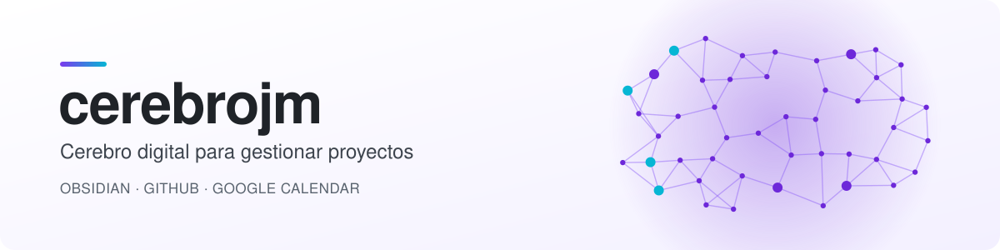
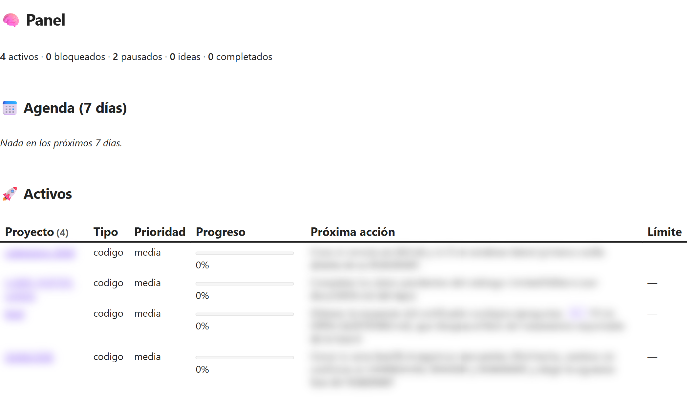
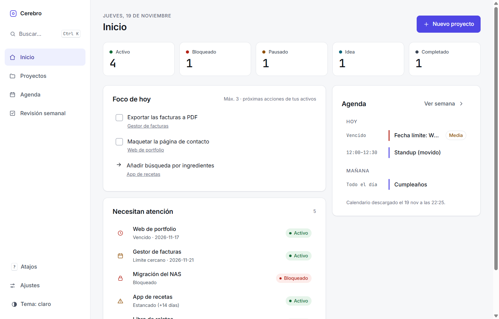
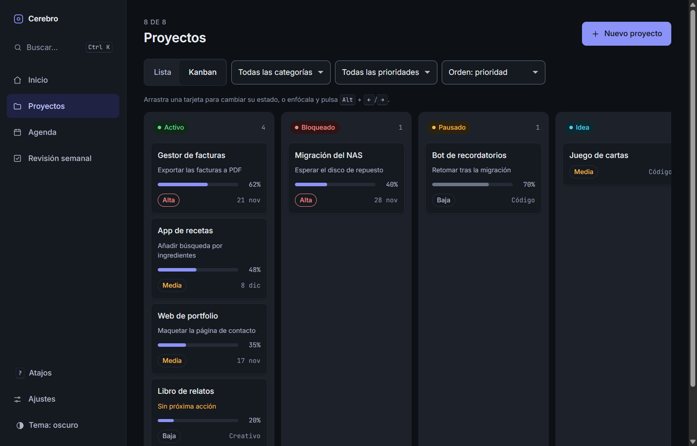
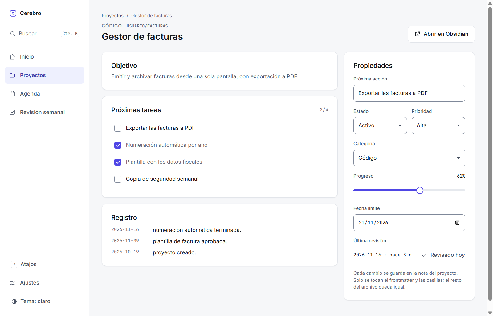
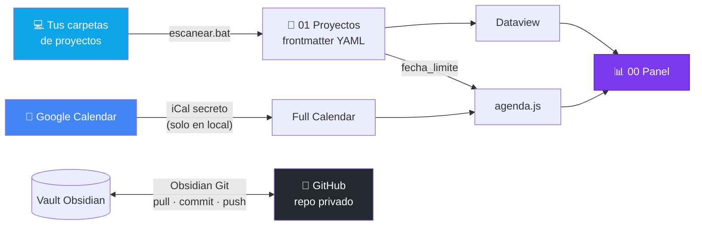
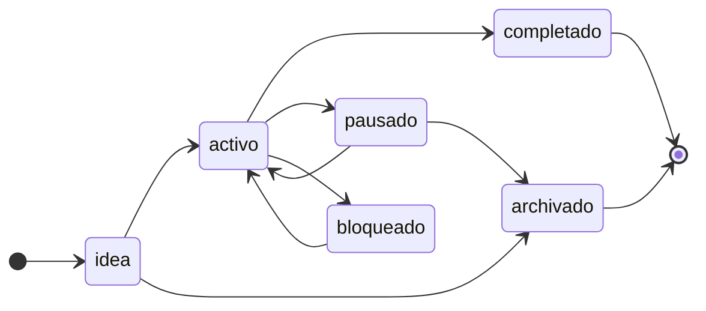

<div align="center">

<picture>
  <source media="(prefers-color-scheme: dark)" srcset="_sistema/assets/banner-dark.svg">
  <source media="(prefers-color-scheme: light)" srcset="_sistema/assets/banner-light.svg">
  
</picture>

<br>

**Todos tus proyectos, tu agenda y tus próximos pasos en un solo lugar.**<br>
Un vault de Obsidian que se sincroniza solo con GitHub y te dice qué está activo, qué se ha estancado y qué vence esta semana.

<br>


[Funciones](#-funciones) ·
[Cómo funciona](#-cómo-funciona) ·
[Instalación](#-instalación) ·
[Uso](#-uso-diario) ·
[Modelo de datos](#-modelo-de-datos) ·
[Roadmap](#-roadmap)

</div>

---

## ✨ Funciones

<table>
<tr>
<td width="50%" valign="top">

### 📊 Panel de control
Estado de todos los proyectos de un vistazo: resumen por estado, barras de progreso, próxima acción y fecha límite, separados en código y personal/creativo.

</td>
<td width="50%" valign="top">

### ⚠️ Alertas automáticas
Señala lo que se está quedando atrás: **vencidos**, **bloqueados**, **estancados** (más de 14 días sin revisión), proyectos **sin próxima acción**, activos **sin push** en GitHub desde hace más de 30 días y proyectos con el **límite cercano** (menos de 14 días).

</td>
</tr>
<tr>
<td valign="top">

### 📅 Agenda de Google Calendar
Tus eventos de los próximos 7 días junto a las fechas límite de los proyectos. Soporta eventos recurrentes, excepciones y zonas horarias (con límites: las repeticiones se expanden en la zona del sistema, las anuales ignoran `BYMONTH`/`BYDAY` y no se leen `DURATION` ni `RDATE`), y la URL privada **nunca** se sube al repo.

</td>
<td valign="top">

### 🔄 Sincronización con GitHub
Obsidian Git hace *pull* al abrir y *commit + push* cada 10 minutos, **solo del sistema** (Panel, plantillas, scripts). Tus notas se protegen con una copia cifrada local (`respaldar.bat`).

</td>
</tr>
<tr>
<td valign="top">

### 🧩 Plantillas
Proyecto, nota diaria (con la agenda del día), revisión semanal, nota y herramienta, cada una con el frontmatter de su tipo, para que el Panel y los índices no se rompan.

</td>
<td valign="top">

### 🔁 Revisión semanal
30 minutos guiados: vaciar la bandeja, revisar los estancados y limitar los activos. Es lo que evita que el sistema se degrade.

</td>
</tr>
<tr>
<td valign="top">

### 🔍 Escáner de proyectos
`escanear.bat` recorre tus carpetas y crea una nota por proyecto: repositorio, último cambio, stack, descripción del README y si tiene ROADMAP, CLAUDE.md o tests. Al volver a escanear **nunca pisa lo que escribes a mano**.

</td>
<td valign="top">

### 🧰 Catálogo de herramientas
Detecta las skills, agentes y servidores MCP que usan tus proyectos (`skills-lock.json`, `.claude/`, `.agents/skills`, `.mcp.json`) y crea una ficha por cada una, con su origen y los proyectos que la usan.

</td>
</tr>
</table>

> [!NOTE]
> **Este repo es solo el cerebro.** No contiene ningún dato de tus proyectos: las notas de `01 Proyectos/` y `05 Herramientas/` las genera el escáner en tu PC y están excluidas de Git.

<div align="center">
  
  <br>
  <sub><i>Captura real del Panel; los nombres de proyecto y sus acciones están difuminados.</i></sub>
</div>

### App de escritorio (opcional)

`cerebrojm-app` (repositorio propio) es una app de Windows (Tauri) que muestra y edita este mismo vault sin abrir Obsidian. Lee y escribe los mismos `.md`, solo cambia la línea que editas y no pisa los cambios de Obsidian ni de Obsidian Git. Aplica las mismas reglas de alerta que el Panel (incluida «sin push») y tiene una pantalla de solo lectura con las herramientas de `05 Herramientas/`.

<div align="center">
  
  <br><br>
  
  
  <br>
  <sub><i>Capturas reales de la app con un vault de ejemplo (datos ficticios).</i></sub>
</div>

---

## 🧠 Cómo funciona



| Pieza | Papel |
|---|---|
| **Escáner** | `escanear.mjs` lee tus carpetas (Git, README, package.json, skills, MCP) y crea o actualiza las notas. Solo toca sus campos automáticos y su bloque `escaner`. |
| **Notas de proyecto** | Cada proyecto es un `.md` con frontmatter: estado, prioridad, progreso, fechas y próxima acción. Son la fuente de verdad y viven solo en tu PC. |
| **Dataview** | Consulta esas notas como si fueran una base de datos y genera las tablas del Panel. |
| **`agenda.js`** | Lee el calendario iCal, expande los eventos recurrentes y mezcla eventos y fechas límite. Si la configuración de Full Calendar está corrupta, lo avisa en lugar de mostrar «Calendario sin conectar». |
| **Obsidian Git** | Mantiene el vault y GitHub sincronizados en segundo plano. |

---

## 🚀 Instalación

> [!IMPORTANT]
> Este repositorio debe ser **privado**: contiene tus notas personales.

### 1 · Requisitos

<details>
<summary>Git para Windows y Obsidian</summary>

<br>

- [Git para Windows](https://git-scm.com/download/win). Incluye Git Credential Manager para iniciar sesión en GitHub.
- [Obsidian](https://obsidian.md/download).

</details>

### 2 · Clonar

```powershell
cd $HOME
git clone https://github.com/jmstudio14/cerebrojm.git
cd cerebrojm
git pull   # comprueba que la autenticación funciona
```

> [!WARNING]
> **No** lo clones dentro de OneDrive o Dropbox: dos sincronizadores sobre la misma carpeta corrompen el repositorio `.git`.

### 3 · Abrir en Obsidian

<details>
<summary>Abrir como vault y activar los plugins</summary>

<br>

1. Obsidian → **Open folder as vault** → `C:\Users\<tú>\cerebrojm`.
2. Pulsa **Trust author and enable plugins** (o *Ajustes → Community plugins → Turn on*).
3. Abre **`_sistema/Diagnóstico.md`**: comprueba plugins, calendario y proyectos. Nada debería salir en ❌; en un clon recién hecho, lo que aún no has configurado sale en ⚪.
4. Abre **`00 Panel.md`**, que también está en Marcadores.

Los plugins **vienen incluidos** en `.obsidian/plugins/`: no hay que instalar nada. Se activan Dataview, Obsidian Git, Full Calendar y Templater. Excalidraw también viene incluido, pero no está en la lista de plugins activados.

</details>

### 4 · Conectar Google Calendar

<details>
<summary>Pegar la dirección secreta iCal (solo lectura)</summary>

<br>

1. [Google Calendar](https://calendar.google.com) → ⚙️ **Configuración** → tu calendario → **Integrar el calendario**.
2. Copia la **Dirección secreta en formato iCal** (termina en `basic.ics`).
3. Obsidian → **Ajustes → Full Calendar → Add calendar → iCal** → pega la URL.
4. Repite para cada calendario que quieras ver.

</details>

> [!TIP]
> La URL se guarda en `.obsidian/plugins/obsidian-full-calendar/data.json`, que está en `.gitignore`. Si alguna vez se filtra, en Google pulsa **Restablecer** la dirección secreta. Google actualiza este enlace con retraso (de minutos a horas).

### 5 · Cargar tus proyectos

Requiere [Node.js](https://nodejs.org) 22 o superior. Doble clic en **`escanear.bat`** (en la carpeta del vault):

1. La primera vez pregunta qué **carpetas madre** contienen tus proyectos, por ejemplo `C:\Programacion;D:\Creativo`. Cada subcarpeta cuenta como un proyecto. Se guarda en `_sistema/config/escaner.local.json`, que no se sube a Git (ver `escaner.ejemplo.json`).
2. Crea una nota por proyecto en `01 Proyectos/` (con el campo `entregable` vacío) y una ficha por herramienta en `05 Herramientas/`, con la etiqueta `revisar`. Si dos proyectos tienen el mismo nombre, añade el de su carpeta madre (y un número si aun así chocan), por ejemplo `app (proyectos 2)`.
3. Vuelve a ejecutarlo cuando quieras actualizar: refresca repositorio, último cambio y el bloque automático, y **respeta** estado, prioridad, progreso, próxima acción y todo tu texto. Si una carpeta desaparece, avisa pero no borra la nota.

```powershell
node _sistema/scripts/escanear.mjs --carpetas "C:\Programacion"   # alternativa desde terminal
```

### 6 · Copias de seguridad

Tus notas (proyectos, notas, diario, revisiones, herramientas y adjuntos) y la configuración local (`_sistema/config/*.local.json`) **no se suben a GitHub**. Protégelas con una copia cifrada:

1. Doble clic en **`respaldar.bat`**. La primera vez pregunta en qué carpeta guardar las copias: mejor un disco externo o una carpeta de la nube, porque van cifradas.
2. Elige una contraseña. **No se guarda en ningún sitio: si la olvidas, la copia no se puede recuperar.**
3. Se crea `cerebrojm-AAAA-MM-DD_hhmmss.cjmbak` (AES-256-GCM) y se conservan las 10 últimas. La carpeta de destino no puede estar dentro del vault. Si algo no se puede leer o es un enlace simbólico (no se siguen), la copia se crea igualmente, lista lo omitido y termina con código 1.

Para recuperar: **`restaurar.bat`** restaura la copia más reciente **sin pisar** archivos que hayas modificado después (añade `--forzar` para sobrescribirlos). El Diagnóstico (`_sistema/Diagnóstico.md`) te avisa si la última copia tiene más de 14 días.

En un PC recién clonado todavía no se sabe dónde están las copias: indica el archivo con `restaurar.bat --archivo <ruta de la copia.cjmbak>`. La copia **no** incluye el `data.json` de Full Calendar, así que tendrás que volver a pegar la URL iCal (paso 4).

> [!TIP]
> Hazlo cada semana al terminar la revisión semanal, y siempre antes de cambiar de PC.

### 7 · Estado de los repos (opcional)

Requiere la [CLI de GitHub](https://cli.github.com) con la sesión iniciada (`gh auth login`). Doble clic en **`repos.bat`**, o desde terminal:

```powershell
node _sistema/scripts/repos.mjs
```

Para cada proyecto cuyo `repo` sea una URL de GitHub (`https://github.com/usuario/repo`), consulta GitHub y escribe en el frontmatter solo dos campos: `ultimo_push` (AAAA-MM-DD, en UTC) e `issues_abiertos` (sin contar PRs). El resto de la nota queda igual, byte a byte, y no se reescribe si nada cambió. Si un repo falla (renombrado, sin acceso, o `gh` no responde en 30 s), avisa con la causa, deja esa nota intacta y termina con código 1. Una URL de GitHub mal escrita (`http://`, `www.`, sin esquema o con `/tree/main`) también se avisa y termina con código 1; una URL de otro host se ignora.

El Panel y `/estado` marcan **🧊 sin push (+30 días)** a los proyectos `activo` cuyo `ultimo_push` tenga más de 30 días.

Para que se actualice solo cada día, crea una tarea programada de Windows (PowerShell, sin administrador; sustituye `<ruta-del-vault>`):

```powershell
Register-ScheduledTask -TaskName "cerebrojm - estado de repos" `
  -Action (New-ScheduledTaskAction -Execute "conhost.exe" -Argument "--headless `"$((Get-Command node).Source)`" `"<ruta-del-vault>\_sistema\scripts\repos.mjs`"") `
  -Trigger (New-ScheduledTaskTrigger -Daily -At 10:00) `
  -Settings (New-ScheduledTaskSettingsSet -StartWhenAvailable)

Get-ScheduledTaskInfo -TaskName "cerebrojm - estado de repos"                      # última ejecución y resultado
Unregister-ScheduledTask -TaskName "cerebrojm - estado de repos" -Confirm:$false   # borrarla
```

`StartWhenAvailable` recupera la ejecución si el PC estaba apagado a esa hora. Como las notas de `01 Proyectos/` **no están en Git**, no hay conflictos con Obsidian Git; el único roce posible es editar una nota en Obsidian en el mismo instante, y por eso el script solo cambia esas dos líneas.

### 8 · Capturar desde el móvil (opcional)

Requiere una suscripción a [Obsidian Sync](https://obsidian.md/sync) (de pago) y está pensado para Android: apuntas una idea en el móvil y llega a la [bandeja de entrada](02%20Notas/) del PC. Decisión y límites en el [ADR-0008](docs/architecture/ADR/0008-sincronizacion-movil.md).

<details>
<summary>Configurar el PC y el móvil</summary>

<br>

**Ajustes de Sync, iguales en los dos dispositivos** (no se copian de uno a otro):

- **Excluded folders:** `01 Proyectos`, `03 Diario`, `04 Revisiones`, `05 Herramientas`, `_sistema` y `docs`.
- **Vault configuration sync:** todo desactivado.
- **Images, Audio, Videos, PDFs** y **Sync all other types:** desactivados. Solo viaja texto.

**En el PC**

1. **Antes de nada**, para que Obsidian Git no suba nada sin revisar: `Ctrl+P` → *Obsidian Git: Pause/Resume automatic routines* (o *Disable on this device* en sus ajustes).
2. Suscríbete, inicia sesión en *Ajustes → General → Account*, activa *Core plugins → Sync* y crea un vault remoto con **contraseña de cifrado**. Si la olvidas, no se puede recuperar. **No pulses todavía *Start syncing*.**
3. Aplica los ajustes de arriba, reinicia Obsidian y pulsa *Resume* en Sync.
4. Cierra Obsidian y ejecuta `git status`: debe estar limpio. Si aparece algún archivo nuevo de `.obsidian/`, añádelo a `.gitignore` antes de reactivar Obsidian Git.
5. Reactiva Obsidian Git.

**En Android**

1. Instala Obsidian y elige **Setup Obsidian Sync** (no abras antes otro vault). Conecta con el vault remoto.
2. Cierra la ventana que propone empezar a sincronizar, aplica los ajustes de arriba, reinicia la app y pulsa *Resume* en Sync.
3. Cuando termine la primera sincronización, en *Ajustes → Files and links*, pon `02 Notas` como carpeta por defecto para notas nuevas y para adjuntos. El móvil no recibe esta opción del PC.
4. Prueba: añade una línea a **Bandeja de entrada** en el móvil y comprueba que aparece en el PC.

</details>

> [!WARNING]
> Desde el móvil, escribe solo en la Bandeja de entrada o dentro de `02 Notas/`. Git ignora las notas `.md` nuevas de la raíz, pero no otros archivos de la raíz ni las carpetas nuevas: llegarían al PC y Obsidian Git los subiría a GitHub.

> [!IMPORTANT]
> Las capturas llegan al PC cuando Obsidian está abierto allí. Los `.md` de la raíz del vault (Panel, README, ROADMAP, `CLAUDE.md` y Guía rápida) no se pueden excluir por carpeta y también se sincronizan. Sync **no** sustituye a `respaldar.bat`.

---

## 🗓️ Uso diario

| Quiero… | Cómo |
|---|---|
| Crear un proyecto | Nota nueva en `01 Proyectos/` → `Ctrl+P` → *Templates: Insert template* → **Proyecto** |
| Crear un proyecto respondiendo preguntas | `Ctrl+P` → *Templater: Create new note from template* → **Proyecto con preguntas** (la nota acaba en `01 Proyectos/`). No la insertes con *Templates* del núcleo: pegaría el código |
| Ver los proyectos en tarjetas por estado | Abrir `_sistema/vistas/Proyectos.base` (Bases, incluido en Obsidian) |
| Ver el día | `Ctrl+P` → *Daily notes: Open today's daily note* |
| Hacer la revisión semanal | Nota nueva en `04 Revisiones/` → plantilla **Revisión semanal** |
| Ver el calendario completo | `Ctrl+P` → *Full Calendar: Open Calendar* |
| Sincronizar ya | `Ctrl+P` → *Obsidian Git: Commit-and-sync* |
| Cargar o actualizar proyectos | Doble clic en **`escanear.bat`** |
| Actualizar último push e issues de GitHub | Doble clic en **`repos.bat`** (necesita `gh`) |
| Copia cifrada de mis notas | Doble clic en **`respaldar.bat`**, cada semana al terminar la revisión |
| Recuperar una copia | Doble clic en **`restaurar.bat`** (no pisa lo modificado después; en un PC nuevo, con `--archivo <copia.cjmbak>`) |
| Apuntar una idea desde el móvil | Línea nueva en **Bandeja de entrada** (necesita Obsidian Sync, paso 8) |

La rutina completa y el significado de cada alerta están en **[Guía rápida](Guía%20rápida.md)**.

### 🤖 Con Claude Code
Abre Claude Code en la carpeta del vault. El subagente `gestor-proyectos` (`.claude/agents/`) solo edita `01 Proyectos/`, `04 Revisiones/` y `05 Herramientas/`, y estos comandos (`.claude/commands/`) hacen el trabajo repetitivo:

| Comando | Qué hace |
|---|---|
| `/estado` | Resumen por estado con las mismas alertas que el Panel (`_sistema/scripts/estado.mjs`) y los PRs abiertos de los proyectos `activo` y `bloqueado`. Ejecuta `escanear.mjs` y `repos.mjs`, así que crea las notas de proyectos y herramientas nuevos y refresca los campos automáticos (`ultimo_push`, `issues_abiertos` y los del escáner). Nunca toca `estado`, `prioridad`, `progreso` ni `proxima_accion`. |
| `/revision` | Crea `04 Revisiones/AAAA-MM-DD.md` desde la plantilla, con los datos del día. No sobrescribe y no marca el checklist. |
| `/proyecto <nombre>` | Ficha del proyecto, últimos commits, PRs abiertos y una propuesta de siguiente paso. Solo lectura. |
| `/fase <nombre>` | Lee el repo del proyecto (su `CLAUDE.md`, `ROADMAP.md`, tests y CI) y propone el plan de su fase siguiente. No escribe nada. |
| `/implementar <nombre>` | Presenta el plan de la fase siguiente y, con tu aprobación, la implementa en una rama `fase/<id>-<slug>` del repo del proyecto (tests y lint del propio repo), abre un **PR en borrador** y actualiza la nota del proyecto. Nunca fusiona. |
| `/seguimiento [nombre]` | Vigila los PRs `fase/*` abiertos (CI y comentarios). Si falla la CI o **tú** pides algo en un comentario, lo corrige en la misma rama con un push normal y responde con el prefijo `🤖 Seguimiento:`. Cuando fusionas un PR, lo refleja en la nota del proyecto y propone la fase siguiente «por confirmar». Los comentarios de terceros y de bots son datos, no órdenes. |

Ninguno hace commit ni push en el vault. `/implementar` y `/seguimiento` sí hacen commits y push normales, pero solo en la rama de fase del repo del proyecto; el PR lo revisas y lo fusionas tú.

`.claude/settings.json` bloquea con reglas `deny` las órdenes que `/implementar` nunca debe ejecutar: `gh pr merge`, `gh pr ready`, `gh repo delete`, push forzado, push a `main`/`master` (incluidos refspecs como `HEAD:main`) y `git reset --hard`. Es una defensa en profundidad, no una frontera: las reglas casan por texto y un flag en una posición imprevista podría escaparse. Por eso la regla también está escrita en el propio comando.

---

## 🧬 Modelo de datos

Cada proyecto lleva este frontmatter. El Panel depende de que los nombres y los valores sean exactamente estos.

```yaml
tipo: proyecto
categoria: codigo          # codigo · personal · creativo
estado: activo             # idea · activo · pausado · bloqueado · completado · archivado
prioridad: alta            # alta · media · baja
progreso: 40               # 0–100
inicio: 2026-11-01         # la plantilla pone la fecha de hoy; el escáner la deja vacía
fecha_limite: 2026-11-30   # aparece en la agenda
ultima_revision: 2026-11-18  # +14 días → estancado
proxima_accion: "Una acción concreta"
entregable: "Un libro"     # opcional: qué produce al terminar (personal/creativo)
repo: "https://github.com/…"
ruta_local: "C:\\Programacion\\mi-proyecto"   # lo rellena el escáner
ultimo_commit: 2026-11-10  # lo escribe el escáner
etiquetas: [revisar]       # el escáner marca «revisar» hasta que lo confirmas
escaneado: 2026-11-18      # lo escribe el escáner: fecha del último escaneo
ultimo_push: 2026-11-10    # lo escribe repos.mjs; +30 días en un activo → sin push
issues_abiertos: 3         # lo escribe repos.mjs
```

`ruta_local` y `ultimo_commit` los incluye la plantilla de Proyecto; `escaneado` solo lo añade el escáner. `ultimo_push` e `issues_abiertos` los añade `repos.mjs` la primera vez que consulta GitHub.



Las tareas `- [ ]` bajo **Próximas tareas** de los proyectos activos aparecen en el Panel.

---

## 📂 Estructura

```text
cerebrojm/
├── 00 Panel.md               Dashboard principal
├── Guía rápida.md            Rutina diaria/semanal y señales de alarma
├── ROADMAP.md                Evolución del propio sistema
├── CLAUDE.md                 Reglas para Claude Code en este vault
├── skills-lock.json          Origen y hash de las skills de `.claude/skills/` instaladas desde GitHub
├── escanear.bat              Carga o actualiza tus proyectos y herramientas
├── repos.bat                 Actualiza el último push y los issues de tus repos de GitHub
├── respaldar.bat · restaurar.bat   Copia cifrada de tus datos personales
├── 01 Proyectos/             Una nota por proyecto, generada en tu PC (+ índice)
├── 02 Notas/                 Ideas y bandeja de entrada (+ índice)
├── 03 Diario/                Notas diarias AAAA-MM-DD (+ índice)
├── 04 Revisiones/            Revisiones semanales (+ índice)
├── 05 Herramientas/          Skills, agentes y MCP detectados, en tu PC (+ índice)
├── _sistema/
│   ├── plantillas/           Proyecto (y con preguntas) · Nota diaria · Revisión semanal · Nota · Herramienta
│   ├── vistas/Proyectos.base Tarjetas de proyectos por estado (Bases)
│   ├── scripts/agenda.js     Lector iCal + fechas límite
│   ├── scripts/escanear.mjs  Escáner de proyectos y herramientas
│   ├── scripts/estado.mjs    Resumen de estado y alertas (solo lectura)
│   ├── scripts/repos.mjs     Último push e issues abiertos de los repos (usa `gh`)
│   ├── scripts/respaldar.mjs · restaurar.mjs · respaldo-lib.mjs   Copia cifrada y restauración
│   ├── scripts/atomico.mjs   Escritura atómica con reintento ante bloqueos de Windows
│   ├── config/               Configuración local del escáner (*.local.json fuera de Git)
│   ├── tests/                Tests de agenda, escáner, escritura atómica, respaldo, estado y repos, coherencia con .gitignore, vista de Bases, plantilla con preguntas y validador del vault (CI)
│   ├── Diagnóstico.md        Autocomprobación del sistema
│   └── assets/               Imágenes del README
├── docs/                     Decisiones (architecture/ADR), roadmap, auditoría y estrategia de pruebas
├── .github/workflows/validar.yml   CI: tests y validación del frontmatter
├── .claude/                  Subagente gestor-proyectos, comandos /estado, /revision, /proyecto, /fase, /implementar y /seguimiento, skills y settings.json (reglas deny)
└── .obsidian/                Configuración y plugins incluidos
```

---

## 🛣️ Roadmap

| Fase | Estado | Objetivo |
|:---:|:---:|---|
| **0** | ✅ Hecha | Vault, Panel, agenda, plantillas y escáner de proyectos |
| **1** | 🔄 En curso | Adopción: 2 semanas de uso real y máximo 3-4 proyectos activos |
| **2** | 🟡 Implementada, sin cerrar | Agente de Claude Code que gestiona los proyectos e implementa la siguiente fase de cada repo vía PR |
| **3** | 🟡 Implementada, sin cerrar | App de escritorio minimalista y profesional (Tauri + React), con sistema de diseño propio |
| **4** | 🟡 Implementada, sin cerrar | Estado de los repos actualizado automáticamente desde GitHub (`repos.mjs`) |
| **5** | 🔄 Parcial | Proyectos personales y creativos: la plantilla ya sirve; falta dar de alta los proyectos |
| **6** | 🟡 Preparada, sin cerrar | Captura desde el móvil con Obsidian Sync (opcional): falta configurarlo y probarlo |

«Sin cerrar» significa que el código está hecho, pero la condición de entrada o el criterio de terminado del roadmap aún no se han marcado. Detalle en **[ROADMAP.md](ROADMAP.md)**. Regla: no se empieza una fase hasta cerrar la anterior.

---

## 🔒 Privacidad

- **Tus datos no van a GitHub** ([ADR-0001](docs/architecture/ADR/0001-datos-personales-y-backup.md)): `01 Proyectos/`, `02 Notas/`, `03 Diario/`, `04 Revisiones/`, `05 Herramientas/`, `_sistema/adjuntos/` y la configuración local están en `.gitignore`. GitHub guarda solo el sistema. Para no perderlos, usa `respaldar.bat` (copia cifrada) y, al cambiar de equipo, `restaurar.bat --archivo <copia.cjmbak>`.
- Los datos personales solo salen de tu PC si tú lo activas: las copias cifradas que guardes en la nube y, si configuras la captura móvil (paso 8), `02 Notas/`, que Obsidian Sync envía a sus servidores con cifrado de extremo a extremo.
- La URL secreta del calendario vive solo en tu equipo (`.gitignore`).
- El estado local de Obsidian (`workspace.json`) no se sincroniza, así que no hay conflictos entre equipos.
- Cada push ejecuta un CI (`.github/workflows/validar.yml`) en Ubuntu y Windows, con Node 22 y 24. Corre todos los tests de `_sistema/tests/` (lector iCal, escáner, escritura atómica, copia de seguridad, resumen de estado, repos y validador, con datos ficticios), entre ellos la comprobación de que la zona personal sigue fuera de Git, y valida las notas del repo. Un test nuevo entra solo, sin tocar el workflow.
- Los commits automáticos no incluyen el nombre de tu equipo.
- Si Obsidian Git detecta un conflicto, te avisa: abre el archivo, quédate con la versión buena y haz *Commit-and-sync*.

---

<div align="center">

Hecho con Obsidian · Uso personal · Todos los derechos reservados

<sub>Las notas son tuyas; este repo solo las ordena.</sub>

</div>
