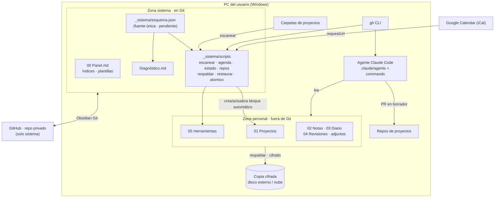
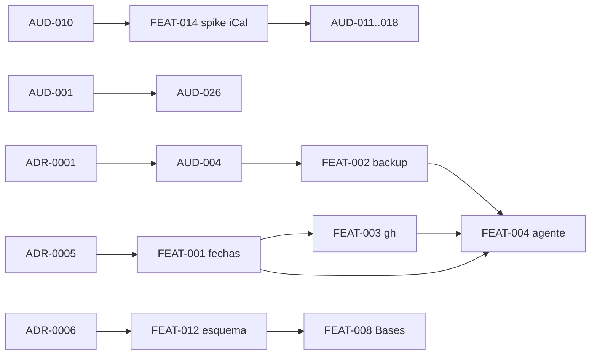

# Arquitectura objetivo de CerebroJM

> **Principio rector:** evolucionar sin perder la simplicidad.
> Un vault de Markdown y unos pocos scripts locales de Node, sin servidores ni microservicios. Toda complejidad nueva tiene que justificarse con un caso de uso.

## 1. Vista general

## 2. Componentes

### 2.1 Obsidian (interfaz y almacenamiento)
- **Responsabilidad:** edición, navegación, vistas (Dataview, Bases) y almacenamiento en Markdown.
- **Tecnología:** Obsidian, Dataview 0.5.68 (ya incluido) y Bases (núcleo).
- **Complemento:** app Tauri en el repo `cerebrojm-app`, ya construida ([ADR-0003](ADR/0003-interfaz-obsidian-frente-a-app.md)).
- **Dependencias:** plugins de la comunidad.
- **Riesgos:** cambios en la API de Dataview; plugins sin mantenimiento (AUD-034).
- **Mantenimiento:** bajo.
- **Justificación:** ya existe, es Markdown abierto y no hace falta construir nada.

### 2.2 Separación sistema / personal
- **Responsabilidad:** que ningún dato personal llegue a GitHub.
- **Tecnología:** `.gitignore` y la convención de carpetas ([ADR-0001](ADR/0001-datos-personales-y-backup.md)).
- **Alternativas:** repo de datos aparte, `git-crypt` u Obsidian Sync.
- **Riesgos:** sin copia de seguridad, se pierden datos (de ahí 2.3).
- **Mantenimiento:** muy bajo, más un test de CI (`git check-ignore`).

### 2.3 Copia de seguridad y restauración
- **Responsabilidad:** recuperar la zona personal ante pérdida o cambio de equipo.
- **Tecnología:** scripts de Node sin dependencias: `node:crypto` (AES-256-GCM con clave derivada por scrypt) y `node:zlib`.
- **Alternativas:** Obsidian Sync; copia manual.
- **Dependencias:** Node.
- **Riesgos:** pérdida de la contraseña; copias no programadas. Lo mitiga el aviso de antigüedad en el Diagnóstico.
- **Mantenimiento:** bajo.
- **Justificación:** es la única opción que cumple "nada personal en GitHub" sin coste recurrente.

### 2.4 Escáner de proyectos
- **Responsabilidad:** derivar datos **automáticos** (repositorio, fechas, stack y herramientas; los datos de GitHub los escribe `repos.mjs`) sin tocar los datos manuales.
- **Tecnología:** Node ≥ 22 sin dependencias y `git`.
- **Diseño interno (SRP):** hoy es un solo archivo de 470 líneas; la escritura atómica ya está en `atomico.mjs`. Se recomienda separarlo en módulos con responsabilidades únicas:
  - `detectores/` (git, stack, tests, herramientas);
  - `frontmatter.js` (parse/serialize tolerante, AUD-001);
  - detección de conflictos al escribir (AUD-026, pendiente);
  - `esquema.js`;
  - `cli.js`.

  Cada detector es una función pura `(dir) → datos`, fácil de probar (DRY con el validador).
- **Alternativas:** script de PowerShell (no se puede probar en la CI de Linux).
- **Riesgos:** rendimiento con muchos proyectos (procesos `git`). Se mide con un test.
- **Mantenimiento:** medio.

### 2.5 Calendario
- **Responsabilidad:** mostrar en el Panel los eventos de los próximos N días y las fechas límite.
- **Tecnología:** `ical.js` copiado en el vault si el spike lo valida; si no, parser propio corregido ([ADR-0002](ADR/0002-motor-icalendar.md)).
- **Configuración:** independizarse del `data.json` de Full Calendar mediante `_sistema/config/calendario.local.json` (AUD-034). Full Calendar pasa a ser opcional y solo para la vista mensual.
- **Riesgos:** cuota de `localStorage`; disponibilidad de `requestUrl`.
- **Mantenimiento:** bajo con biblioteca, medio-alto con parser propio.

### 2.6 Esquema único
- **Responsabilidad:** una sola definición de campos, valores, rangos y umbrales ([ADR-0006](ADR/0006-esquema-unico-de-metadatos.md)).
- **Tecnología:** JSON leído por Node y por DataviewJS.
- **Mantenimiento:** muy bajo.

### 2.7 Integración con GitHub
- **Responsabilidad:** último push e issues abiertos por proyecto (`repos.mjs`). Los PRs los consultan los comandos con `gh`; releases y estado de la CI no se recogen.
- **Tecnología:** `gh` CLI, local y bajo demanda ([ADR-0007](ADR/0007-integracion-github-local.md)).
- **Alternativas:** Action programada (incompatible con ADR-0001); API REST con token en disco.
- **Riesgos:** límites de la API, que hay que contemplar en la paginación.
- **Mantenimiento:** bajo.

### 2.8 Agente de proyectos
- **Responsabilidad:** consultar, planificar e implementar fases autorizadas mediante PR ([ADR-0004](ADR/0004-agente-de-proyectos.md)).
- **Tecnología:** Claude Code (subagente más comandos) en el vault; `gh` para los PRs.
- **Riesgos:** cambios incorrectos en repos con pocas pruebas. Lo mitigan el plan previo, la ausencia de merge y la evidencia de tests.
- **Mantenimiento:** bajo: son archivos Markdown de instrucciones.

### 2.9 Tareas
- **Responsabilidad:** tareas con vencimiento y prioridad, y vistas globales.
- **Tecnología:** campos en línea de Dataview. Plugin *Tasks* solo si la recurrencia es necesaria (FEAT-005).

### 2.10 Conocimiento
- **Responsabilidad:** captura, relación y recuperación.
- **Tecnología:** Obsidian nativo (búsqueda, enlaces, Bases) y plantilla de decisiones.
- **Excluido:** búsqueda semántica y *embeddings* hasta que exista un caso de uso (FEAT-010).

## 3. Lo que esta arquitectura evita a propósito

- Servidores, bases de datos y microservicios.
- Una segunda fuente de verdad: la app lee y escribe los mismos `.md`.
- Dependencias npm en el código propio: cada una exige un ADR o una justificación en el backlog.
- Automatizaciones remotas sobre datos personales.

## 4. Orden de dependencia

