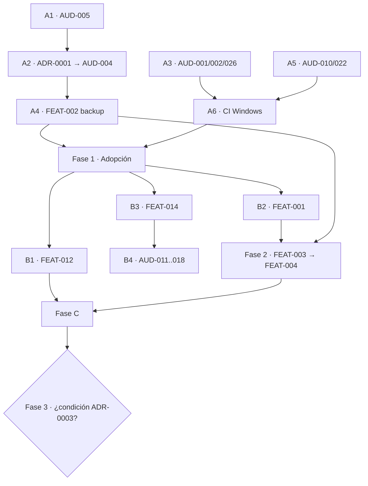

# Roadmap maestro de evolución

> **Foto del 2026-11-18.** No se actualiza: el estado vigente está en [ROADMAP](../../ROADMAP.md) y [BACKLOG](../roadmap/BACKLOG.md).

> Propuesta derivada de la auditoría del 2026-11-18. **No sustituye a `ROADMAP.md` hasta que se apruebe.** La sección 3 resume los cambios que habría que aplicar a `ROADMAP.md` una vez aprobada.

## 1. Principios

1. **Primero no perder datos, después funcionalidades.** Ningún P0 abierto al empezar a usar el sistema en real.
2. **Una fase cada vez** (regla actual de `ROADMAP.md`), con una excepción: los P0 se corrigen en cuanto se aprueben, porque la regla de congelación ya permite "corregir fallos".
3. **TDD:** cada corrección empieza con un test que falla (RED), registrado en el PR.
4. **Toda fase termina con evidencia:** CI en verde y una lista de comprobación manual firmada cuando se necesite Obsidian o Windows.

## 2. Fases

### Fase A · Endurecimiento previo a la adopción (nueva, antes de la Fase 1)
**Objetivo:** que el usuario pueda empezar a escribir datos manuales sin riesgo de perderlos ni de publicarlos.

| Orden | Elementos | Motivo del orden |
|---|---|---|
| A1 | AUD-005 (rama de respaldo y referencias de PR) | Exposición actual de datos; acción manual del usuario |
| A2 | ADR-0001 aprobado → AUD-004 | Define qué es personal antes de construir la copia |
| A3 | AUD-001, AUD-002, AUD-026 | Corrupción de datos en el escáner |
| A4 | FEAT-002 (copia y restauración) → cierra AUD-003 | Requiere A2 |
| A5 | AUD-010, AUD-022 | La agenda y el índice de herramientas no deben romperse enteros |
| A6 | AUD-039 (parte: CI en Windows y fixtures de A3 y A5) | Garantiza que A3 y A5 no vuelvan a fallar |

**Terminado si:**
- No queda ningún P0 abierto.
- La CI está en verde en Ubuntu y Windows.
- Se ha hecho un simulacro de restauración en el PC del usuario.
- `git ls-remote` no muestra datos personales.

### Fase 1 · Adopción (sin cambios respecto a `ROADMAP.md`)
- Clonar, ejecutar el escáner y el Diagnóstico, hacer la primera revisión y usarlo dos semanas.
- **Añadido:** hacer una copia con FEAT-002 al terminar la primera revisión.

### Fase B · Fiabilidad de datos y calendario
| Orden | Elementos |
|---|---|
| B1 | FEAT-012 (esquema único y validación local) → AUD-029, AUD-030 |
| B2 | FEAT-001 (modelo temporal) → AUD-020, AUD-021, AUD-024 |
| B3 | FEAT-014 (spike de `ical.js`) → decisión del ADR-0002 |
| B4 | AUD-011 a AUD-018 y AUD-036, según el resultado de B3 |
| B5 | AUD-023, 025, 031, 033, 034, 006, 027, 028 |

**Terminado si:**
- Los tests RED de todos los elementos están en verde.
- El Panel muestra "sin actividad" y "sin revisión" por separado.
- La agenda coincide con Google Calendar en un calendario real durante una semana (comprobación manual).

### Fase 2 · Agente de proyectos (la Fase 2 actual, con requisitos explícitos)
- **Requiere:** Fase 1 cerrada, FEAT-001 y FEAT-002.
- **Orden:**
  1. FEAT-003 (`gh`).
  2. FEAT-004 en el orden 2a → 2b → 2c → 2d de `ROADMAP.md`.
- **Terminado si:** se cumplen los criterios de aceptación de FEAT-004 y dos fases reales están implementadas mediante PR fusionado por el usuario.

### Fase C · Productividad
- FEAT-005 (tareas), FEAT-006 (decisiones), FEAT-008 (Bases), FEAT-009 (catálogo ampliado).

### Fase 3 · App de escritorio (condicionada)
- Solo si se cumple la condición de entrada del ADR-0003 tras las Fases C y 1.

### Fases 5 y 6 · Proyectos personales y móvil (sin cambios)
- La Fase 6 decide el mecanismo de sincronización entre dispositivos para la zona personal (ADR-0001, consecuencias). FEAT-007 depende de ella.

### Retirada · Fase 4 de `ROADMAP.md`
- La "GitHub Action que actualiza `ultimo_push`" no es compatible con el ADR-0001. La sustituye FEAT-003 (ADR-0007), que se adelanta a la Fase 2.

## 3. Cambios propuestos para `ROADMAP.md` (aplicar solo tras la aprobación)

1. Insertar la **Fase A** antes de la Fase 1.
2. **Fase 4:** sustituir su contenido por una referencia a FEAT-003 y ADR-0007, o eliminarla.
3. Cambiar `ultimo_push` por `ultimo_commit` (AUD-027).
4. Añadir la **Fase B** después de la Fase 1 y la **Fase C** después de la Fase 2.
5. Registrar en "Registro de cambios" la adopción de este roadmap maestro.

## 4. Mapa de dependencias

## 5. Lo que este roadmap no promete

- Fechas. No hay estimaciones de tiempo: solo complejidad relativa en el backlog.
- Que `ical.js` funcione en DataviewJS: lo decide el spike FEAT-014.
- Que las consultas del Panel funcionen en Obsidian: no se ha verificado. Es el primer punto de la Fase 1.
